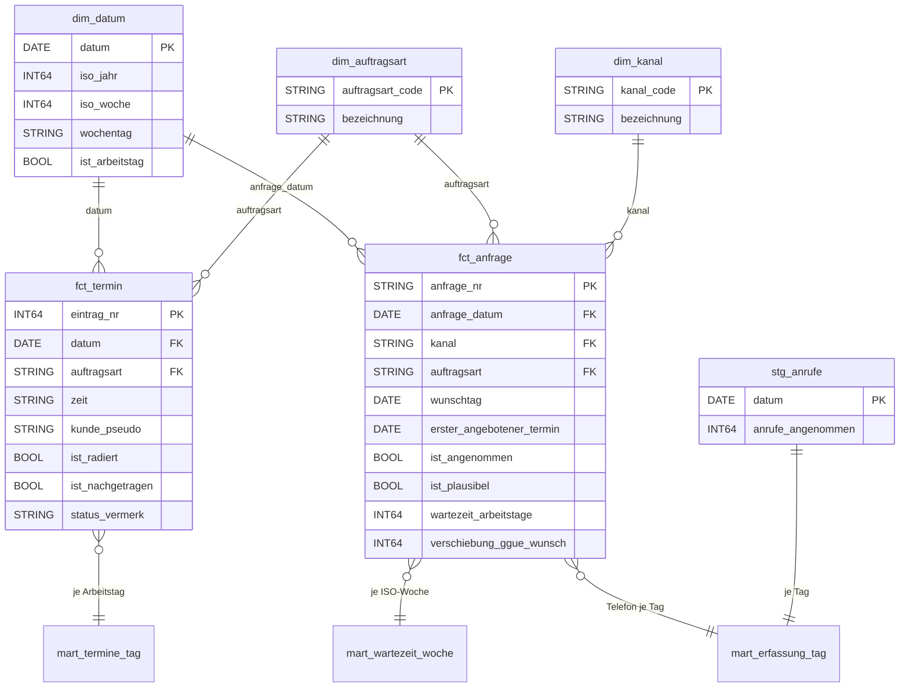

# Garage Keller: Dokumentation der MVP-Pipeline

Alle Zahlen stammen aus dem letzten Lauf vom 17.11.2026 (`dbt build`: 31 PASS, 5 WARN, 0 ERROR) im Projekt
`daeng-haurikim-9gjm`. **Die Daten sind synthetisch**; jede Mart-Zeile trägt `datenstatus = 'synthetisch'`.

Ablauf: `garage/ingest/load.sh` lädt die vier CSV-Dateien unverändert nach `gs://<projekt>-raw/garage/version=2026-11-17/`
und von dort als STRING-Tabellen nach `garage_raw`. Das dbt-Projekt `garage/transform` baut daraus
`garage_staging` → `garage_intermediate` (Star-Schema) → `garage_marts`.

## 1. Datenmodell

Zwei Faktentabellen teilen sich die Dimensionen Datum und Auftragsart; die Anrufstatistik bleibt im Staging,
weil sie nur als Nenner der Kontrolle G-02 dient.

## 2. Transformationslogik je Modell

| Modell | Schicht | Logik in einem Satz |
|---|---|---|
| `stg_termine` | staging | Terminbuch typisiert, Zeit von `10.00` auf `10:00` vereinheitlicht, ja/nein zu BOOL, leerer Vermerk zu NULL. |
| `stg_reifenhotel` | staging | Reifenhotel typisiert, Dimension in Grossbuchstaben ohne Leerzeichen (aus 6 Schreibweisen werden 4), leerer Wechselstatus zu NULL. |
| `stg_anfragen` | staging | Anfrageliste typisiert, fehlender Kanal wird `unbekannt`, `ist_plausibel` falsch bei fehlendem oder zu frühem Termin. |
| `stg_anrufe` | staging | Anrufstatistik typisiert, eine Zeile pro Tag. |
| `dim_datum` | intermediate | Lückenloser Kalender vom kleinsten bis zum grössten Datum aller Quellen (28.09.–27.11.2026, 61 Tage) mit ISO-Woche, Wochentag und Arbeitstag. |
| `dim_auftragsart` | intermediate | Die fünf Auftragsarten aus dem Seed `auftragsart`. |
| `dim_kanal` | intermediate | Die vier Kanäle aus dem Seed `kanal`. |
| `fct_termin` | intermediate | Ein Eintrag im Terminbuch pro Zeile, radierte und nachgetragene Einträge bleiben gekennzeichnet drin. |
| `fct_anfrage` | intermediate | Eine Anfrage pro Zeile mit Wartezeit und Verschiebung in Arbeitstagen, beide nur bei plausiblen Anfragen. |
| `mart_wartezeit_woche` | marts | Fasst die Anfragen je ISO-Woche zu Fallzahl, mittlerer Wartezeit, Verschiebung und Ablehnungsquote zusammen. |
| `mart_termine_tag` | marts | Zählt die Termine je Arbeitstag mit Einträgen, mit Notfällen, radierten und unklaren Einträgen. |
| `mart_erfassung_tag` | marts | Teilt je Tag der Anrufstatistik die Telefon-Einträge durch die angenommenen Anrufe und markiert Tage unter der Schwelle. |

Hilfsmakro `arbeitstage_zwischen(start, ende)`: Anzahl Montag bis Freitag im Intervall (start, ende], entspricht
`NETZWERKTAGE(start; ende) − 1` in Excel; NULL bei fehlendem Datum oder ende vor start.

## 3. Metrik-Definitionen

**mart_wartezeit_woche (IR-03)**, eine Zeile pro ISO-Woche des Anfragedatums:

| Spalte | Definition |
|---|---|
| `n_anfragen` | Alle Anfragen der Woche, auch unplausible. |
| `n_mit_wartezeit` | Anfragen mit berechneter Wartezeit, also plausible. |
| `mittlere_wartezeit` | Mittel von `arbeitstage_zwischen(anfrage_datum, erster_angebotener_termin)`, 2 Stellen. |
| `mittlere_verschiebung` | Mittel von `arbeitstage_zwischen(wunschtag, erster_angebotener_termin)`, 2 Stellen; zeigt den Engpass ohne den Wunsch der Kundschaft nach einem späteren Tag. |
| `ablehnungsquote` | Anteil `ist_angenommen = false` an allen Anfragen, 3 Stellen. |
| `n_unplausibel` | Anfragen ohne angebotenen Termin oder mit Termin vor der Anfrage. |
| `ist_aussagekraeftig` | `n_mit_wartezeit >= mindestfallzahl` (Variable, 20). |

**mart_termine_tag (IR-01, eingeschränkt)**, eine Zeile pro Arbeitstag mit Einträgen:

| Spalte | Definition |
|---|---|
| `n_termine` | Alle Einträge im Terminbuch an diesem Tag, auch radierte. |
| `n_notfaelle` | Einträge mit `ist_nachgetragen`. |
| `n_radiert` | Einträge mit `ist_radiert`. |
| `n_auftragsart_unklar` | Einträge mit Auftragsart `unklar`. |
| `hinweis` | Fester Text: „Nur Terminzahl. Planungsquote nicht berechenbar, Aufwand fehlt (E-02).“ |

**mart_erfassung_tag (Kontrolle G-02)**, eine Zeile pro Tag aus `stg_anrufe`:

| Spalte | Definition |
|---|---|
| `anrufe_angenommen` | Aus der Anrufstatistik. |
| `eintraege_telefon` | Anfragen mit Kanal `Telefon` und diesem Anfragedatum. |
| `verhaeltnis` | `eintraege_telefon / anrufe_angenommen`, 3 Stellen. |
| `befund` | `prüfen`, wenn das ungerundete Verhältnis unter `schwelle_erfassung` (Variable, 0.5) liegt, sonst `ok`. |

Alle Marts haben zusätzlich `datenstatus` aus der Variable `datenstatus`.

### Ergebnisse des letzten Laufs

| Woche | n_anfragen | n_mit_wartezeit | mittlere_wartezeit | mittlere_verschiebung | ablehnungsquote | n_unplausibel | aussagekräftig |
|---|---|---|---|---|---|---|---|
| 2026-47 | 60 | 60 | 2.92 | 0.80 | 0.100 | 0 | ja |
| 2026-48 | 44 | 42 | 2.64 | 0.57 | 0.182 | 2 | ja |

`mart_termine_tag`: 20 Arbeitstage (28.09.–23.10.2026), 199 Termine, kleinster Tag 7, grösster 13 Termine.

`mart_erfassung_tag`: 10 Tage, Befund `prüfen` am 17.11. (0.389), 24.11. (0.375) und 25.11.2026 (0.417);
am 20.11. und 27.11. liegt das Verhältnis genau auf der Schwelle 0.5 und gilt als `ok`.

## 4. Tests

**Harte Tests** (severity error) schützen das Modell; schlägt einer fehl, endet `dbt build` mit Fehler. Letzter Lauf: alle 17 PASS.

| Test | Schützt | Ergebnis |
|---|---|---|
| unique + not_null `fct_termin.eintrag_nr` | Kein Termin doppelt gezählt | PASS |
| unique + not_null `fct_anfrage.anfrage_nr` | Keine Anfrage doppelt gewichtet | PASS |
| unique + not_null `dim_datum.datum` | Join auf den Kalender vervielfacht nichts | PASS |
| unique + not_null `stg_anrufe.datum` | Nenner von G-02 nicht verdoppelt | PASS |
| relationships `fct_anfrage.kanal` → `dim_kanal` | Kein unbekannter Kanal | PASS |
| relationships `fct_anfrage.auftragsart`, `fct_termin.auftragsart` → `dim_auftragsart` | Keine neue Codierung unbemerkt | PASS |
| relationships `fct_anfrage.anfrage_datum`, `fct_termin.datum` → `dim_datum` | Kein Fakt fällt beim Join weg | PASS |
| accepted_values `stg_anfragen.kanal` | Nur Telefon, Theke, E-Mail, unbekannt | PASS |
| `assert_wartezeit_woche_eine_zeile_pro_woche` | Körnung des Marts | PASS |
| `assert_erfassung_verhaeltnis_plausibel` (kein Verhältnis > 1.5) | Verknüpfung Anfragen–Anrufe | PASS |
| `assert_marts_datenstatus_gesetzt` | Jede Mart-Zeile trägt den Datenstatus | PASS |

**Datenqualitäts-Tests** (severity warn) melden bekannte, dokumentierte Befunde (T-03 bis T-05, PR-08, PR-16),
ohne die Antwort zu verhindern. Letzter Lauf: 5 WARN.

| Test | Befund | Zeilen |
|---|---|---|
| not_null `stg_anfragen.erster_angebotener_termin` | Anfrage ohne angebotenen Termin (A-080) | 1 |
| `dq_anfragen_kanal_bekannt` | Anfrage ohne erfassten Kanal | 1 |
| `dq_anfragen_plausibel` | Unplausible Anfragen (A-080 ohne Termin, A-095 Termin vor Anfrage) | 2 |
| `dq_termine_auftragsart_klar` | Terminbuch-Einträge mit Auftragsart `unklar` | 7 |
| not_null `stg_reifenhotel.wechsel_status` | Radsätze ohne vermerkten Herbstwechsel | 152 |

## 5. Bekannte Grenzen

- **Synthetische Daten:** Die Pipeline beweist, dass Ablauf, Modell und Tests funktionieren; über die Garage Keller sagen die Zahlen nichts.
- **Keine Feiertage:** Arbeitstage sind Montag bis Freitag; ein Feiertag zählt als Arbeitstag, die Wartezeit wäre dann um einen Tag zu hoch.
- **Keine Planungsquote:** Für IR-01 fehlt der Aufwand je Termin (E-02); `mart_termine_tag` zeigt nur die Terminzahl.
- **Nicht notierte Anfragen sind unsichtbar:** Die Wartezeit beruht nur auf Anfragen, die in der Liste stehen. `mart_erfassung_tag` zeigt, an welchen Tagen vermutlich Anfragen fehlen, kann sie aber nicht ersetzen.
- **Zeiträume passen nicht zusammen:** Das Terminbuch deckt 28.09.–23.10.2026 ab, Anfragen und Anrufe 16.–27.11.2026; Termine und Anfragen lassen sich deshalb nicht direkt verknüpfen.
- **Schwellen sind vorläufig:** `mindestfallzahl` (20) und `schwelle_erfassung` (0.5) sind mit dem Inhaber noch zu vereinbaren.
