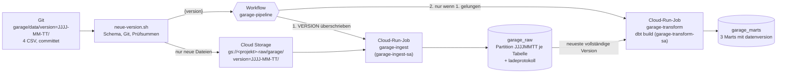

# Wiederholbarkeit: eine neue Lieferung mit einem Befehl

Spezifikation: `SPEC-PIPELINE.md`, Prompts: `PROMPTS-PIPELINE.md`. Projekt `daeng-haurikim-9gjm`, Region europe-west6.
Stand: 25.11.2026, Lieferungen `version=2026-11-17` und `version=2026-12-14`. **Alle Daten sind synthetisch.**

Bis Woche 10 hat `ingest/load.sh` die Rohdaten vom Laptop aus geladen und mit `--replace` überschrieben,
und dbt lief lokal. Neu ist jede Lieferung ein Ordner im Git, und ein Befehl bringt sie in die Cloud und
baut die Marts neu. Jede Version bleibt erhalten, ein zweiter Lauf ändert nichts, und eine fehlerhafte
Lieferung erreicht die Marts nicht.

## 1. Ablauf

| Teil | Datei | Aufgabe |
|---|---|---|
| Befehl | `neue-version.sh` | Lieferung lokal prüfen, Git als Quelle durchsetzen, unveränderliche Versionen im Bucket, Workflow starten, Ergebnis zeigen |
| Schema | `ingest-job/schema.json` | Dateien, Tabellen und Spalten; dieselbe Datei prüfen Skript und Job |
| Ingest | `ingest-job/` | Lieferung im Bucket prüfen, je Tabelle in die Partition der Version laden (`WRITE_TRUNCATE`), Zeilen zählen, `ladeprotokoll` anfügen |
| Transformation | `transform/` | Makro `neueste_version()` wählt die neueste Version mit allen vier Tabellen im Protokoll; jedes Staging-Modell liest nur diese Partition |
| Verkettung | `pipeline/workflow.yaml` | Ingest, dann Transformation, ohne Wiederholungen und ohne Parallelität |

Identitäten: jeder Teil hat einen eigenen Service-Account mit nur den Rechten, die er braucht
(`ingest-job/README.md`, `pipeline/README.md`). Eine bewusste Abweichung von der Spezifikation:
`garage-pipeline-sa` hat zusätzlich `roles/run.viewer`, weil `run.jobsExecutorWithOverrides` den Job
zwar startet, das Warten auf sein Ende aber eine Leseberechtigung auf dem Projekt braucht.

## 2. Eine neue Lieferung einspielen

1. Ordner `garage/data/version=JJJJ-MM-TT/` mit den vier CSV anlegen, gleiche Dateinamen und Kopfzeilen wie bisher.
2. Committen: `git add garage/data/version=JJJJ-MM-TT && git commit -m "Lieferung JJJJ-MM-TT"`.
3. `bash garage/neue-version.sh JJJJ-MM-TT`

Das Skript bricht vor dem ersten Upload ab, wenn eine Datei fehlt, eine Kopfzeile nicht passt oder der
Ordner nicht committet ist. Liegt die Version schon im Bucket und eine Datei unterscheidet sich, bricht es
ebenfalls ab: Eine Korrektur ist eine neue Version mit neuem Datum. Eine ältere Version lässt sich lokal
reproduzieren mit `dbt build --profiles-dir . --vars '{version: "2026-11-17"}'`.

## 3. Drei Eigenschaften mit Beleg

**Versioniert.** Jede Lieferung bleibt in Storage und BigQuery erhalten. Nach dem Laden von 2026-12-14
liegen in `garage_raw` beide Partitionen nebeneinander: 20261117 mit 199 / 189 / 104 / 10 Zeilen,
20261214 mit 404 / 192 / 211 / 20. Die Marts tragen die Spalte `datenversion` und zeigen 2026-12-14.
Wird danach nochmals 2026-11-17 gestartet, bleiben die Marts auf 2026-12-14 (Job-Log:
«Datenversion 2026-12-14 (ladeprotokoll)»). Mit `--vars` ergibt 2026-11-17 wieder genau die Werte aus
`ABNAHME.md`.

**Idempotent.** Der zweite Lauf von 2026-12-14 hat keine Datei hochgeladen («alle Prüfsummen gleich,
nichts hochgeladen», Zeitstempel im Bucket unverändert), dieselben Zeilenzahlen und dieselben Marts
ergeben. Der Ingest ersetzt nur die Partition seiner Version, deshalb entstehen keine Duplikate. Nur
`ladeprotokoll` wächst, weil es jeden Lauf festhält (2026-11-17: 12 Einträge aus 3 Läufen).

**Mit Schranke.** Eine fehlerhafte Lieferung erreicht die Marts nicht, an zwei Stellen:
- Lokal: eine Kopie von 2026-12-14 mit umbenannter Spalte (`kanal_neu`) bricht `neue-version.sh` mit
  Exit-Code 1 ab und nennt erwartete und gefundene Spalten; im Bucket ist nichts angekommen.
- In der Cloud: der Workflow mit einer Version, die es im Bucket nicht gibt (2099-01-02), endet FAILED.
  `garage-ingest` bricht in der Prüfung der Lieferung ab, `garage-transform` startet nicht, die Marts
  bleiben auf 2026-12-14. Weil das Protokoll erst nach allen vier Tabellen geschrieben wird, zählt auch
  eine halb geladene Version für dbt nie als vollständig.

## 4. Akzeptanzkriterien (Lauf vom 25.11.2026)

| Kriterium | Soll | Ist | Ergebnis |
|---|---|---|---|
| 2026-11-17: `garage_raw`, Partition 20261117 | 199 / 189 / 104 / 10 | 199 / 189 / 104 / 10 | PASS |
| 2026-11-17: `ladeprotokoll` | 4 Zeilen | 4 Zeilen (erster Lauf) | PASS |
| 2026-11-17: Marts wie `ABNAHME.md`, `datenversion` 2026-11-17 | alle Werte | alle Werte | PASS |
| 2026-12-14: Partition 20261214 | 404 / 192 / 211 / 20 | 404 / 192 / 211 / 20 | PASS |
| 2026-12-14: Partition 20261117 unverändert | 199 / 189 / 104 / 10 | 199 / 189 / 104 / 10 | PASS |
| 2026-12-14: `mart_wartezeit_woche` | 4 Zeilen, `datenversion` 2026-12-14 | 4 Zeilen, `datenversion` 2026-12-14 | PASS |
| Woche 47 | 60 / 60 / 2.92 / 0.80 / 0.100 / 0 | 60 / 60 / 2.92 / 0.8 / 0.1 / 0 | PASS |
| Woche 48 | 44 / 42 / 2.64 / 0.57 / 0.182 / 2 | 44 / 42 / 2.64 / 0.57 / 0.182 / 2 | PASS |
| Woche 49 | 58 / 57 / 2.79 / 0.56 / 0.086 / 1 | 58 / 57 / 2.79 / 0.56 / 0.086 / 1 | PASS |
| Woche 50 | 49 / 49 / 3.06 / 0.80 / 0.143 / 0 | 49 / 49 / 3.06 / 0.8 / 0.143 / 0 | PASS |
| `mart_termine_tag` | 40 Zeilen, 199 + 205 = 404, min 7, max 13 | 40 Zeilen, 199 + 205 = 404, min 7, max 13 | PASS |
| `mart_erfassung_tag` | 20 Zeilen, «prüfen» am 17.11., 24.11., 25.11., 03.12., 04.12. | 20 Zeilen, dieselben fünf Tage | PASS |
| Zweiter Lauf 2026-12-14 | kein Upload, alles unverändert | kein Upload, alles unverändert | PASS |
| Nochmals 2026-11-17 | Marts bleiben auf 2026-12-14 | 2026-12-14 | PASS |
| Lokal `--vars '{version: "2026-11-17"}'` | Werte aus `ABNAHME.md` | PASS=32, WARN=5, ERROR=0, Werte aus `ABNAHME.md` | PASS |
| Danach `garage-transform` | Marts auf 2026-12-14 | 2026-12-14 | PASS |
| Negativtest 1: umbenannte Spalte | Abbruch vor dem Hochladen | Exit-Code 1, nichts im Bucket | PASS |
| Negativtest 2: Version fehlt im Bucket | Ingest scheitert, Transform startet nicht, Marts bleiben | Workflow FAILED, keine neue Transform-Execution, Marts 2026-12-14 | PASS |

Die Werte der Wochen sind n_anfragen / n_mit_wartezeit / mittlere_wartezeit / mittlere_verschiebung /
ablehnungsquote / n_unplausibel. BigQuery gibt 0.80 als `0.8` aus; der Wert ist derselbe.
`dbt build` hat einen harten Test mehr als in `ABNAHME.md` (genau eine `datenversion` pro Mart), daher
PASS=32 statt 31; die fünf Warnungen sind dieselben bekannten Datenqualitäts-Befunde.

## 5. Grenzen

- **Kein Zeitplan.** Lieferungen entstehen, wenn jemand die Papierlisten der Garage abtippt, unregelmässig.
  Ein Zeitplan hätte meist nichts Neues zu laden und würde eine Automatik vortäuschen, die es an der Quelle
  nicht gibt. Der Auslöser bleibt der Mensch, der die Lieferung committet und `neue-version.sh` startet.
- **Snapshot-Annahme.** Jede Version gilt als vollständiger Stand aller vier Listen: alte Zeilen bleiben,
  neue kommen dazu. Deshalb wertet dbt immer genau eine Version aus. Käme eine Lieferung nur mit den neuen
  Zeilen (Delta), würden die Marts die alten Wochen verlieren; die Pipeline prüft diese Annahme nicht.
- **Synthetische Daten.** Beide Lieferungen sind erfunden (`tools/erzeuge_version_2026-12-14.py`). Die
  Zahlen belegen, dass Ablauf, Versionierung und Schranke funktionieren, nicht wie lange Kundschaft bei der
  Garage Keller wartet.
